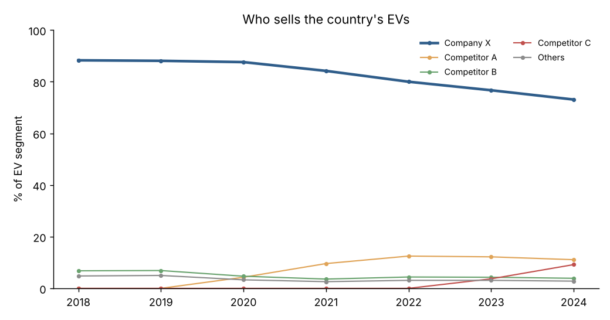
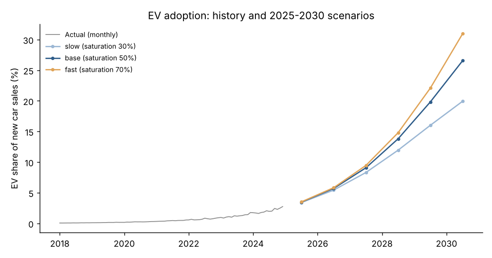

# Strategic Analysis of the Automotive Market

Case study of **Company X**, a car maker that holds **73% of its country's electric
vehicle (EV) segment** while most of its volume is still petrol, diesel and CNG.
The questions:

1. How big is the EV opportunity, and how much of it can Company X keep?
2. Where are EV and petrol (gasoline) sales heading to 2030?
3. What should Company X improve to stay the EV leader?

The output is a strategy report: [`reports/strategy_report.md`](reports/strategy_report.md).

> **Data note:** the dataset is a **simulated case study** (`scripts/generate_case_data.py`).
> Brands and models are fictional. The market behaviour (early-stage S-curve EV adoption,
> diesel decline, festive-season peaks, the 2020 lockdown dip) is modelled on real
> emerging car markets. To run the same analysis on real data, replace the three CSVs
> in `data/raw/` using the same columns (see `data/README.md`).

## Key findings

| | |
|---|---|
| Company X share of EV segment | 73.1% in 2024 (peak 88.3%) |
| EV share of all new cars | 2.1% in 2024, growing ~78% a year |
| 2030 EV share (slow / base / fast) | 20% / 27% / 31% |
| Biggest threat | Competitor C: +5.5 pp of the EV segment in one year |
| Biggest weakness | X-City EV (volume EV) scores 2.7/5 on range, 2.9/5 on charging |
| Value of defending share | ~356k extra EV units in 2030 vs current trend (base case) |



## Approach

**1. Market analysis** (`src/market.py`)
Fuel mix by year, CAGR and YoY growth per fuel type, EV segment share by brand,
Company X's model mix and customer review scores.

**2. Forecast: EV vs petrol to 2030** (`src/forecast.py`)
EV share is modelled as a logistic S-curve `L / (1 + e^(-k(t - t0)))`. Because EVs are
still only ~2% of the market, the saturation level `L` can't be estimated from the data;
I checked this in the notebook (the logit transform is linear for L = 30%, 50% and 70%) and in
a backtest:

| Model (fit 2018-2022, test 2023-2024) | MAPE |
|---|---|
| Logistic, L = 30% / 50% / 70% | 5.3% / 5.5% / 5.7% |
| Exponential | 6.2% |
| Linear trend | 43.5% |

So `L` is a scenario input (slow / base / fast) and `k`, `t0` are fitted by linear
regression on the logit-transformed share. Total market growth is a log-linear trend on
yearly totals with 2020 excluded. Petrol share = 1 - EV - (diesel, CNG, hybrid trends).



**3. Market potential** (`src/potential.py`)
3 EV adoption scenarios × 3 share scenarios for Company X (hold share, slow erosion,
current trend continues) → 2030 units and revenue.

**4. SWOT + recommendations** (`src/swot.py`)
Each SWOT point is generated from the numbers above, so it updates if the data changes.

## Project structure

```
automotive-market-strategy/
├── data/raw/                  # market_sales, company_models, model_reviews (CSV)
├── scripts/generate_case_data.py
├── notebooks/market_exploration.ipynb
├── src/
│   ├── data.py                # loading + validation (e.g. model sales add up to company totals)
│   ├── market.py              # descriptive analysis
│   ├── forecast.py            # logistic scenarios, backtest
│   ├── potential.py           # 2030 market sizing
│   ├── swot.py                # data-backed SWOT + recommendations
│   ├── charts.py
│   └── run.py                 # runs everything, writes the report
├── tests/                     # pytest
├── outputs/                   # CSV tables + charts
└── reports/strategy_report.md
```

## How to run

```bash
pip install -r requirements.txt
python scripts/generate_case_data.py     # creates data/raw/*.csv
python -m src.run                        # tables, charts, reports/strategy_report.md
python -m pytest tests
```

## Limitations
- Simulated data: the methods and reasoning are the point, not the exact figures.
- Trend-based forecasts don't model policy (subsidies, fuel taxes, charging rollout).
- Review scores exist only for Company X, so weaknesses are absolute, not vs competitors.
- Revenue uses constant 2024 prices and model mix.

## Tools
Python (pandas, numpy, matplotlib), pytest.
