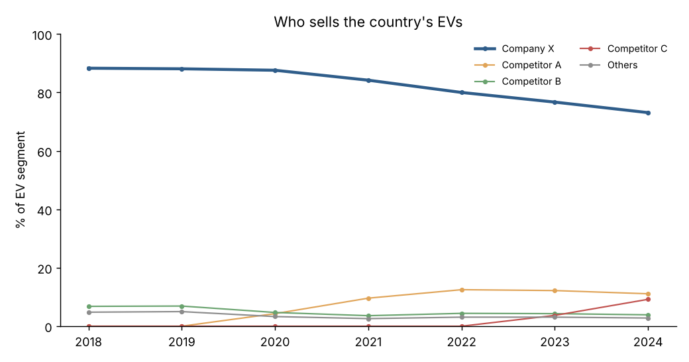
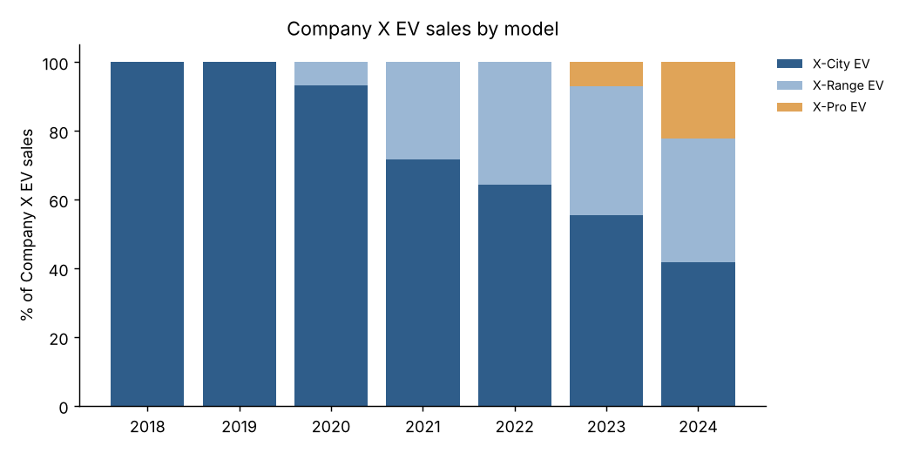
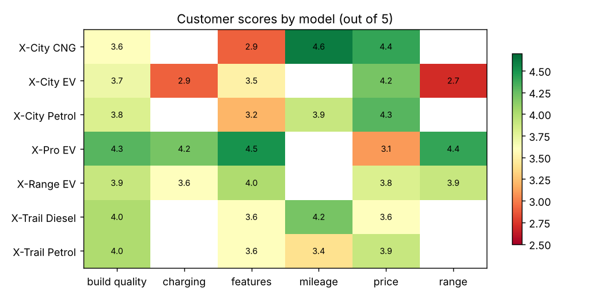
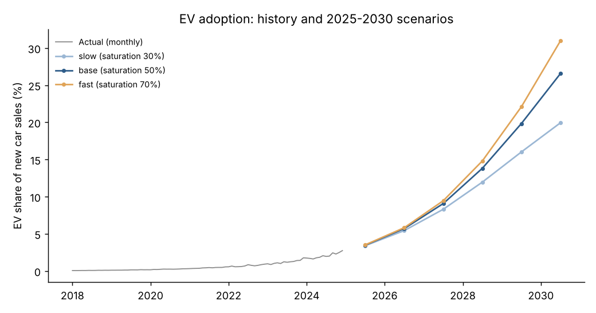
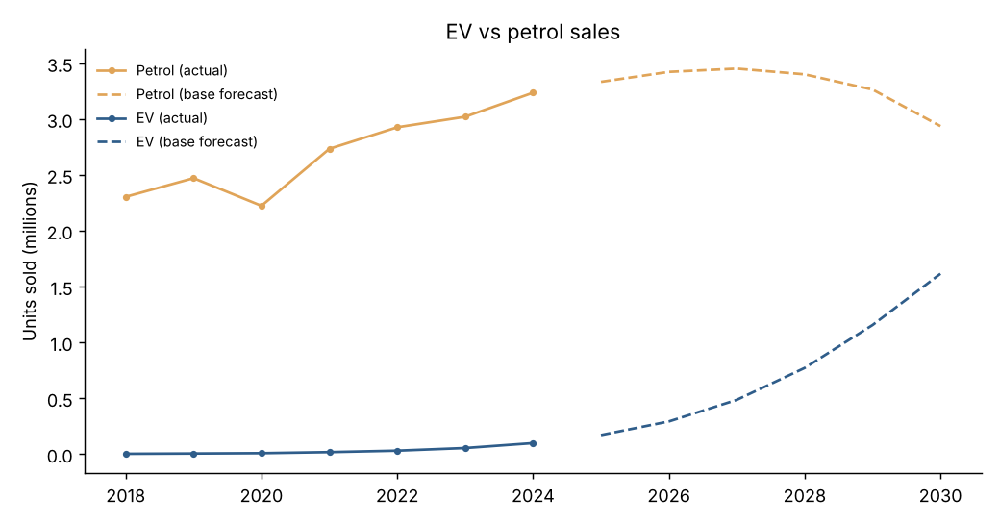

# Strategic Analysis of the Automotive Market: Company X

> Simulated case-study data (see `data/README.md`). Generated by `python -m src.run`.

## 1. Summary
- Company X holds **73.1%** of the country's EV segment (2024), down from 88.3% at its peak.
- EVs are only **2.1%** of new car sales but grew **78% a year** (2019-2024); petrol grew 6%.
- Base scenario: EVs reach **27%** of sales in 2030 (1,616,096 units), petrol falls to 48%.
- Main recommendation: improve the volume EV (X-City EV) on range and charging to defend share.

## 2. Market today
Share of new car sales by fuel type (%):

| year | CNG | Diesel | EV | Hybrid | Petrol |
|---|---|---|---|---|---|
| 2018 | 6.7 | 28.6 | 0.1 | 1.1 | 63.5 |
| 2019 | 7.8 | 26.0 | 0.1 | 1.3 | 64.8 |
| 2020 | 9.4 | 23.5 | 0.2 | 1.5 | 65.3 |
| 2021 | 10.2 | 21.6 | 0.4 | 1.6 | 66.1 |
| 2022 | 11.2 | 18.5 | 0.7 | 1.9 | 67.6 |
| 2023 | 12.6 | 16.3 | 1.2 | 2.1 | 67.8 |
| 2024 | 13.8 | 13.6 | 2.1 | 2.3 | 68.3 |

Growth by fuel type:

| fuel_type | cagr_pct | last_yoy_pct |
|---|---|---|
| CNG | 16.9 | 16.5 |
| Diesel | -8.3 | -11.5 |
| EV | 78.3 | 80.7 |
| Hybrid | 17.6 | 16.8 |
| Petrol | 5.5 | 7.1 |

## 3. Company X
| year | company_market_share_pct | company_share_of_ev_segment_pct | ev_pct_of_company_sales |
|---|---|---|---|
| 2018 | 10.3 | 88.3 | 0.7 |
| 2019 | 10.3 | 88.1 | 1.2 |
| 2020 | 10.3 | 87.6 | 2.1 |
| 2021 | 10.4 | 84.2 | 3.5 |
| 2022 | 10.5 | 80.0 | 5.4 |
| 2023 | 10.8 | 76.7 | 8.7 |
| 2024 | 11.2 | 73.1 | 13.5 |

Models in 2024:

| model | fuel_type | units | yoy_pct | revenue_musd | avg_price_usd | share_of_company_ev_pct |
|---|---|---|---|---|---|---|
| X-City Petrol | Petrol | 195,690 | 5.6 | 2,452.1 | 12,530.0 | - |
| X-Trail Petrol | Petrol | 161,695 | 8.7 | 3,121.2 | 19,303.0 | - |
| X-Trail Diesel | Diesel | 64,564 | -12.1 | 1,339.5 | 20,747.0 | - |
| X-City CNG | CNG | 39,737 | 17.9 | 543.3 | 13,672.0 | - |
| X-City EV | EV | 29,842 | 28.0 | 624.5 | 20,925.0 | 41.7 |
| X-Range EV | EV | 25,897 | 65.8 | 713.2 | 27,541.0 | 36.2 |
| X-Pro EV | EV | 15,888 | 432.3 | 550.0 | 34,616.0 | 22.2 |

## 4. Future trends: EV vs petrol
EV share is modelled as an S-curve (logistic). The market is still near the bottom of the curve, so the saturation level can't be estimated from the data. It is fixed per scenario (slow 30%, base 50%, fast 70%) and the speed/midpoint are fitted.

Backtest (fit to 2018-2022, test on 2023-2024, monthly EV share):

| model | test_mape_pct |
|---|---|
| logistic L=30% | 5.3 |
| logistic L=50% | 5.5 |
| logistic L=70% | 5.7 |
| exponential | 6.2 |
| linear trend | 43.5 |

The logistic scenarios all score about the same, so the data supports the S-curve shape but cannot choose between saturation levels. That is why the forecast is given as scenarios.

| scenario | year | ev_share_pct | ev_units | petrol_share_pct | petrol_units |
|---|---|---|---|---|---|
| slow | 2025 | 3.4 | 167,459 | 68.0 | 3,338,555 |
| slow | 2027 | 8.3 | 444,906 | 65.3 | 3,494,403 |
| slow | 2030 | 19.9 | 1,213,437 | 54.9 | 3,340,613 |
| base | 2025 | 3.5 | 171,071 | 67.9 | 3,334,943 |
| base | 2027 | 9.1 | 486,005 | 64.5 | 3,453,305 |
| base | 2030 | 26.6 | 1,616,096 | 48.3 | 2,937,953 |
| fast | 2025 | 3.5 | 172,664 | 67.9 | 3,333,350 |
| fast | 2027 | 9.5 | 505,991 | 64.2 | 3,433,319 |
| fast | 2030 | 31.0 | 1,883,694 | 43.9 | 2,670,356 |

## 5. EV market potential for Company X (2030)
Revenue uses Company X's 2024 average EV price (US$ 26,354), held constant.

| ev_adoption | company_share_scenario | ev_market_units | company_ev_share_pct | company_ev_units | growth_vs_now_x | revenue_busd |
|---|---|---|---|---|---|---|
| slow | defend (hold share) | 1,213,437 | 73.1 | 886,779 | 12.3 | 23.4 |
| slow | slow erosion (-1.5 pp/yr) | 1,213,437 | 64.1 | 777,570 | 10.8 | 20.5 |
| slow | trend continues (-3.7 pp/yr) | 1,213,437 | 51.0 | 619,435 | 8.6 | 16.3 |
| base | defend (hold share) | 1,616,096 | 73.1 | 1,181,042 | 16.4 | 31.1 |
| base | slow erosion (-1.5 pp/yr) | 1,616,096 | 64.1 | 1,035,594 | 14.4 | 27.3 |
| base | trend continues (-3.7 pp/yr) | 1,616,096 | 51.0 | 824,984 | 11.5 | 21.7 |
| fast | defend (hold share) | 1,883,694 | 73.1 | 1,376,603 | 19.1 | 36.3 |
| fast | slow erosion (-1.5 pp/yr) | 1,883,694 | 64.1 | 1,207,071 | 16.8 | 31.8 |
| fast | trend continues (-3.7 pp/yr) | 1,883,694 | 51.0 | 961,588 | 13.4 | 25.3 |

## 6. SWOT

**Strengths**

- Clear EV leader: 73.1% of the country's EV segment in 2024 (next brand, Competitor A, has 11.1%).
- First mover: selling EVs since 2018, with a 3-model EV range covering compact, mid and premium SUVs.
- EVs are now 13.5% of company sales, up from 0.7%, so the business is already shifting.
- Strong petrol/CNG base (11.2% of the total market) funds the EV transition.

**Weaknesses**

- EV segment share has fallen from 88.3% to 73.1%.
- Best-selling EV (X-City EV) is losing weight in the mix: 42% of company EV sales in 2024, down from 100%; it grew 28% YoY while the EV market grew 81%.
- Low customer score for X-City EV on range: 2.7/5.
- Low customer score for X-City EV on charging: 2.9/5.
- Low customer score for X-Pro EV on price: 3.1/5.

**Opportunities**

- EV sales are growing 78% a year (CAGR) while petrol grows 6%.
- Base scenario: the EV market reaches 1,616,096 units in 2030. Holding today's share means 1,181,042 units (~US$ 31.13 bn), 16.4x today's EV volume.
- X-City Petrol is the company's best seller (195,690 units in 2024); its buyers are a natural upgrade path to X-City EV, which shares the name and body style.

**Threats**

- Competitor C gained 5.5 pp of the EV segment in 2024 alone.
- If the current trend continues, share falls to 51.0% by 2030: 356,058 fewer units than holding share (base scenario).
- EV adoption speed is uncertain: the 2030 EV share ranges from 20% to 31% across scenarios, so capacity plans need flexibility.

## 7. Recommendations

1. **Upgrade X-City EV (range and charging)**: it is the volume EV and the entry point to the brand. A long-range battery option and faster DC charging target its two lowest scores without changing its price advantage (price score is its best aspect).
2. **Add a lower trim of X-Pro EV**: its only weak score is price, and it is the fastest growing EV model, so a cheaper variant could widen its reach.
3. **Track EV segment share monthly against the fastest-growing rival**: in the base scenario, defending share vs letting the trend continue is worth 356,058 units in 2030 alone.
4. **Keep petrol/CNG models but cap new investment**: petrol is still 44-55% of the market in 2030 depending on the scenario, so it funds the EV plan, but its share falls in every scenario.

## 8. Limitations
- Simulated data; methods are the point, not the exact numbers.
- Forecasts are trend-based and ignore policy changes (subsidies, fuel prices), which can move EV adoption a lot.
- Customer scores are averages; no competitor review data, so model weaknesses are judged in absolute terms.
- Revenue assumes constant prices and model mix.
